<!-- ░░░ HEADER ░░░ -->

# Leonardo

**Engenharia de Dados** · **Sistemas Embarcados** · **Engenharia Elétrica**

`do sensor ao dashboard`

 

 

> Estudante de **Engenharia Elétrica na UFRN**, técnico em mecatrônica de formação e
> **estagiário de Engenharia de Dados na Hubbi**, onde construo a plataforma interna de
> operações de dados do maior catálogo de autopeças do Brasil.
>
> O fio que costura tudo: eu gosto de projeto que começa num sensor e termina num gráfico.
> Firmware, pipeline, banco, API e interface — a cadeia inteira.

 

## ⟢ Como as frentes se conectam

```mermaid
flowchart LR
    A["Sensores<br/>tensão · corrente · umidade"]
    B["Firmware<br/>ESP32 · C++"]
    C["Transporte<br/>MQTT · HTTP"]
    D["Ingestão<br/>Celery · Airflow"]
    E["Banco<br/>PostgreSQL · Timescale"]
    F["API<br/>FastAPI"]
    G["Interface<br/>React · TypeScript"]

    A --> B --> C --> D --> E --> F --> G

    classDef hw fill:#210008,stroke:#FF003C,stroke-width:1.5px,color:#FFFFFF
    classDef data fill:#0D1117,stroke:#5B1476,stroke-width:1.5px,color:#FFFFFF
    classDef ui fill:#0D1117,stroke:#995200,stroke-width:1.5px,color:#FFFFFF

    class A,B,C hw
    class D,E,F data
    class G ui
```

 

## `01` Engenharia de Dados

Meu dia a dia. Pipelines de ingestão, qualidade de dados em escala de milhões de
registros e as operações de banco que sustentam o resto da plataforma.

- **Pipelines DAG-driven** — pipelines validadas viram DAGs no Airflow, com blocos
  reaproveitáveis como tasks
- **Qualidade de dados em escala** — EDA, validação de código de barras, normalização e
  deduplicação de catálogo com milhões de linhas
- **Classificação com LLM** — pipelines de categorização com pré-filtro fuzzy antes do
  modelo, para custo previsível
- **Infra de dados** — containers Postgres isolados por dev, cache Redis para consultas
  caras, backup automatizado em S3
- **Agentes de dados** — ferramentas de IA human-in-the-loop que geram SQL auditável em
  vez de executar comandos destrutivos

 

## `02` Sistemas Embarcados & Automação

Onde comecei, e o que não larguei. Projetos que saem da bancada e ficam rodando em
casa, no quintal e na casa da família.

- **Firmware** — ESP32/ESP8266 em C++, RTC, válvulas solenoides, estágios com
  transistor para compatibilizar relés *active-low* com GPIO de 3,3 V
- **Telemetria** — MQTT como espinha dorsal, broker próprio, histórico em série
  temporal
- **Hardware** — medição de energia com ATM90E32, transformadores de corrente SCT-013,
  sensores de tensão ZMPT101B, esquemático em KiCad
- **Legado útil** — estabilização de drone com MPU6050, telemetria RS-485/Modbus,
  refrigeração industrial

 

## `03` Engenharia Elétrica

A base que dá sentido às outras duas. Sistemas de potência, instrumentação e sistemas
digitais — é o que me deixa confortável em colocar um protótipo direto na rede 220 V e
em raciocinar sobre potência ativa e reativa antes de escrever uma linha de firmware.

 

## ⟢ Projetos

| Projeto | O que é | Frente |
| :--- | :--- | :--- |
| **Analisador de Energia** | Medição mono e trifásica de consumo ativo e reativo com ESP32 + ATM90E32, enviando telemetria para dashboard online. Em incubação como produto. | `embarcados` `dados` |
| **Irrigação Automatizada** | Três zonas independentes com ESP32, RTC e válvulas solenoides, migrando a configuração do firmware para um backend multi-proprietário. | `embarcados` |
| **Automação de Ambiente** | Controle e telemetria via ESP8266 e MQTT, com broker próprio como hub central dos projetos. | `embarcados` |
| **Agente de Duplicatas** | Agente de IA que analisa grupos de registros duplicados e devolve SQL auditável, com validação humana fora do loop. | `dados` |

 

## ⟢ Atividade

  

---

### Onde me achar

`220 V` · `3.3 V` · `5432` — todos no mesmo projeto.

